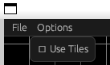
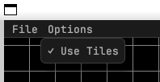

# Soulband Development Log

## 2026-02-19

Spent a bunch of time getting the characters centered in the grid. It looks good! Next up is getting the tileset to work.

Started working on tileset loading and rendering. Added Rust doc comments to the Renderer struct and methods. Cargo doc generates nice HTML documentation!

Got tileset rendering working! The tileset uses 64x64 tiles that we scale down to 32x32 for the game grid. Player character now renders as tile_id 391.

Built a tile_selector utility (`cargo run --bin tile_selector`) to browse the tileset. It has zoom (mouse wheel or Shift+Up/Down), pan (WASD or right mouse drag), and arrow key navigation. You can click tiles to select them and see their tile_id. Really useful for finding the right tiles to use!

## 2026-02-20

### Menu Bar with egui-macroquad

Added a top menu bar using egui-macroquad. The File menu has Save, Load, and Quit options. Only Quit is functional right now - it calls `std::process::exit(0)`. Save and Load are placeholders for when we implement the serialization system.

Added a `draw_menu_bar()` method to the Renderer to keep the UI code organized. The menu uses egui's immediate mode API, which means the UI is rebuilt every frame through closures. It's quite nested but straightforward once you understand the pattern.

Set `default-run = "soulband"` in Cargo.toml so `cargo run` works without needing `--bin soulband`.

### Loading Screen

The 8192x2048 tileset takes a noticeable time to load (PNG decoding + GPU upload). Added a simple loading screen that displays "Loading..." while the tileset loads.

Created a new `ui.rs` module for general UI functions like the loading screen. This will be home to future UI components like dialogs, buttons, and HUD elements.

Explored threading for an animated loading screen. The challenge is that OpenGL contexts are thread-local - you can decode the PNG on a background thread, but GPU texture upload must happen on the main thread. Macroquad's async model makes this tricky without additional complexity. Added it to the todo as a learning exercise for the future.

### Documentation Updates

Updated README with:
- Full dependency installation instructions (Rust, libasound2-dev, X11 libs, OpenGL)
- Description of the game concept (Angband meets Dark Souls)
- Key features and inspirations

Updated the todo list with Save System details and noted the Top Menu System completion.

## 2026-02-21

### Font Selection for Menu Bar

Added JetBrains Mono font to the menu bar. Compared the default egui font with JetBrains Mono to see which looked better for the game's UI. After comparing side by side, the JetBrains Mono font is a nicer font and will be consistent with the ascii mode of the game.

<table>
<tr>
<td> <em>Default egui font</em></td>
<td> <em>JetBrains Mono font</em></td>
</tr>
</table>

### Tile vs ASCII Rendering Toggle

Added an Options menu to the menu bar with a "Use Tiles" toggle. This allows switching between tile-based rendering (using the 64x64 tileset) and ASCII glyph rendering at runtime. The checkmark indicator (✓) shows when tile mode is active.